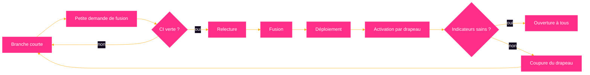

# 02. Livrer

Inspiré de : *Accelerate* (Forsgren, Humble, Kim), le développement trunk-based, *Continuous Delivery* (Humble, Farley).

## Le flux

1. Une branche courte, partie de la branche principale, vivant quelques jours au plus.
2. Une demande de fusion petite : idéalement moins de 400 lignes modifiées. Au-delà, la relecture devient une formalité.
3. Une intégration continue verte, sans exception négociée.
4. Une relecture par au moins une autre personne (voir [Relire le code](04-relire-le-code.md)).
5. Une fusion, puis un déploiement que personne n'a à surveiller les yeux rivés sur l'écran.

Si l'étape 5 fait peur, le problème se situe en amont. On ne le règle pas en déployant moins souvent.

## Séparer déployer et activer

Déployer du code ne signifie pas l'exposer. Un drapeau de fonctionnalité permet de livrer un travail inachevé sans le montrer, d'ouvrir à une poignée d'utilisateurs, de couper en une seconde si les indicateurs se dégradent. Un drapeau a une date de fin ; celui qui traîne depuis six mois est une branche de code mort déguisée.

## Le retour arrière est une fonctionnalité

Chaque mise en production doit pouvoir s'annuler. Les migrations de schéma se font en deux temps : on ajoute, on bascule, et seulement ensuite on retire. Jamais de suppression de colonne dans la même livraison que le code qui cesse de l'utiliser.

## Définition de « fini »

Un changement est fini quand il est :

- en production, pas seulement fusionné ;
- couvert par des tests au bon niveau ;
- observable : on sait, par les journaux ou les métriques, s'il fonctionne ;
- documenté là où quelqu'un le cherchera, c'est-à-dire rarement dans un wiki.

## Ce que j'ai appris à mes dépens

Une livraison qui regroupe trois semaines de travail ne se teste pas mieux, elle se débogue plus mal. Le jour où elle casse, personne ne sait laquelle des quarante modifications est en cause. Les équipes qui livrent tous les jours ont moins d'incidents, pas plus. Les chiffres de DORA le montrent depuis dix ans ; mon expérience le confirme.
