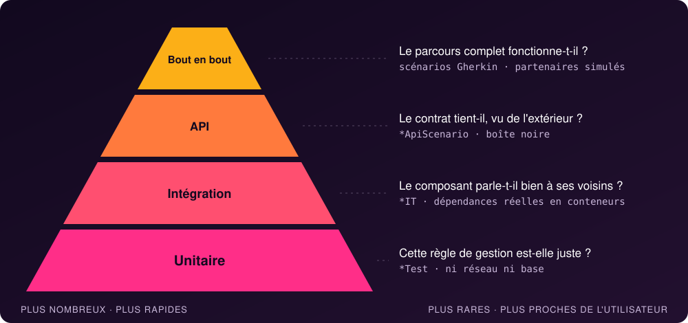

# 03. Tester

Inspiré de : la pyramide des tests (Mike Cohn), *Working Effectively with Legacy Code* (Michael Feathers) pour les tests de caractérisation.

## Une question par niveau

Un test n'est utile que s'il répond à une question précise. Mélanger les niveaux produit des tests lents qui ne prouvent rien.

| Niveau | La question | Ce qu'il touche | Convention de nom |
|---|---|---|---|
| Unitaire | Cette règle de gestion est-elle juste ? | Une classe, sans réseau ni base | `*Test` |
| Intégration | Ce composant parle-t-il correctement à sa base, à sa file, à son voisin ? | Une application et ses dépendances réelles, en conteneurs | `*IT` |
| API | Le contrat exposé tient-il, vu de l'extérieur ? | L'application démarrée, appelée comme un client l'appellerait | `*ApiScenario` |
| Bout en bout | Le parcours utilisateur complet fonctionne-t-il ? | Plusieurs applications, des partenaires simulés | scénarios Gherkin |

Beaucoup de tests unitaires, moins d'intégration, peu de bout en bout. La forme de la pyramide n'est pas un dogme ; c'est une question de coût et de vitesse de retour.

## Trois règles que je ne négocie pas

**Boîte noire au-dessus de l'unitaire.** Un test d'API n'importe aucune classe interne et ne lit pas la base pour vérifier son résultat. Il appelle, il observe la réponse, il rappelle si besoin. Sinon il casse au premier refactoring, alors que rien n'a changé pour l'utilisateur.

**Pas de données préchargées.** Un test crée ce dont il a besoin, par les mêmes chemins qu'un vrai client. Un jeu de données partagé finit toujours par coupler des tests qui ne devraient rien savoir les uns des autres.

**Le même test, partout.** Seule la configuration change entre le poste du développeur, la CI et l'environnement de recette. Un test qui ne passe que « chez moi » n'est pas un test.

## Pas de dogme sur l'ordre

Je n'impose pas d'écrire le test avant le code. J'impose que le code arrive avec ses tests, au bon niveau, et qu'un bug corrigé arrive avec le test qui l'aurait attrapé. La discipline compte plus que le rituel.

## Le filet de non-régression

Avant toute opération lourde (montée de version d'un langage, changement de framework, de base de données), on pose un filet : des tests de caractérisation qui photographient le comportement actuel, défauts compris. Voir [Migrer](08-migrer.md).

## Mesurer la couverture, sans s'y soumettre

La couverture dit ce qui n'est pas testé. Elle ne dit jamais ce qui l'est bien. Je m'en sers pour trouver les angles morts, pas comme objectif chiffré. Sur un projet, la faire passer de 28 % à 83 % a surtout servi à découvrir trois comportements que personne ne savait décrire.
