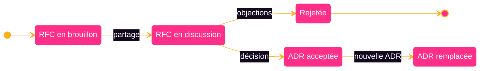

# 05. Décider

Inspiré de : les ADR de Michael Nygard, les processus RFC des projets open source (Rust, Python).

## Deux formats, deux usages

**L'ADR** consigne une décision prise. Une page, pas plus. Contexte, décision, conséquences. On ne la modifie jamais : si la décision change, une nouvelle ADR remplace l'ancienne et le dit. [Modèle](modeles/adr.md).

**La RFC** propose une décision à prendre. Elle circule, elle reçoit des objections, elle évolue. Une fois tranchée, elle donne naissance à une ADR. [Modèle](modeles/rfc.md).

## Quand écrire

- Le choix est coûteux à défaire : une base de données, un protocole, un découpage en services.
- Il touche plus d'une équipe.
- Quelqu'un posera la question « pourquoi on a fait ça ? » dans six mois, et la personne qui sait sera partie.

En dessous de ce seuil, un commentaire dans la demande de fusion suffit.

## Où ranger

Dans le dépôt du code concerné, sous `docs/adr/`, numérotées. La décision vit à côté de ce qu'elle gouverne et suit les mêmes revues.

## Qui tranche

Celui qui porte la responsabilité du résultat. La RFC sert à éclairer, pas à voter. Le consensus est bienvenu quand il arrive ; on ne l'attend pas indéfiniment. Une décision raisonnable prise cette semaine vaut mieux qu'une décision parfaite prise le trimestre prochain.

## Ce que j'ajoute

Chaque ADR liste les **options écartées et pourquoi**. C'est la partie que tout le monde saute et que tout le monde regrette d'avoir sautée. Le jour où le contexte change, c'est elle qui dit si l'option rejetée redevient la bonne.
