# 06. Exprimer un besoin

Inspiré de : le Behaviour-Driven Development (Dan North), Gherkin, *User Story Mapping* (Jeff Patton).

## Partir de l'utilisateur

Une demande commence par la personne qui en profitera et par ce qui l'en empêche aujourd'hui. « Ajouter un champ statut à la table des commandes » est une solution. « Le support ne sait pas dire à un client où en est sa commande » est un besoin. On écrit le second ; l'équipe trouvera le premier, ou mieux.

## Les vrais noms

On désigne les applications par le nom que leur donnent ceux qui s'en servent, pas par leur nom de dépôt. Un responsable produit ne doit pas avoir à traduire, un développeur non plus.

## Trois regards dans une même demande

```mermaid
%%{init: {'theme':'base','themeVariables':{'primaryColor':'#FF2E88','primaryTextColor':'#ffffff','primaryBorderColor':'#FF2E88','lineColor':'#FCAF17','secondaryColor':'#2A0F3D','tertiaryColor':'#FFF0F6','clusterBkg':'#FFF0F6','clusterBorder':'#FF2E88','titleColor':'#12091F','edgeLabelBackground':'#12091F','textColor':'#12091F','transitionLabelColor':'#ffffff','fontFamily':'Segoe UI, Helvetica, Arial, sans-serif','cScale0':'#FF2E88','cScaleLabel0':'#ffffff','cScale1':'#FF7A3D','cScaleLabel1':'#ffffff','cScale2':'#FCAF17','cScaleLabel2':'#12091F','cScale3':'#2EE6A6','cScaleLabel3':'#12091F','cScale4':'#28D9E8','cScaleLabel4':'#12091F','cScale5':'#C04DFF','cScaleLabel5':'#ffffff','cScale6':'#7A5CFF','cScaleLabel6':'#ffffff','cScale7':'#FF4F70','cScaleLabel7':'#ffffff'}}}%%
flowchart LR
  U["Utilisateur bloqué"] --> M["Métier : pour qui, pourquoi, quelle valeur"]
  M --> T["Technique : risques, dépendances, hors périmètre"]
  T --> G["Critères en Gherkin"]
  G --> E["Estimation par l'équipe"]
  E --> L1["Lot 1, le plus petit utile"]
  L1 --> R{"Besoin bien compris ?"}
  R -->|oui| L2["Lots suivants"]
  R -->|non| M
```



Chaque demande sépare explicitement :

- **le métier** : pour qui, pourquoi, quelle valeur, comment on saura que c'est réussi ;
- **la technique** : ce qui est touché, les risques, les dépendances, ce qui est hors périmètre ;
- **l'estimation** : en points, par l'équipe qui fera le travail, jamais par celui qui le demande.

## Des critères vérifiables

Les critères d'acceptation s'écrivent en Gherkin quand le comportement s'y prête :

```gherkin
Fonctionnalité: Suivi de commande par le support

  Scénario: Le support consulte une commande expédiée
    Étant donné une commande expédiée hier
    Quand le support ouvre la fiche du client
    Alors il voit le statut "Expédiée" et la date d'expédition
```

Un critère qu'on ne peut pas transformer en test n'est pas un critère, c'est un souhait.

## Découper en lots

Une demande trop grosse se découpe en lots livrables séparément, chacun utile par lui-même. Le premier lot est le plus petit qui apporte une valeur réelle ; il sert aussi à vérifier qu'on a compris le besoin avant d'investir dans le reste.

[Modèle de demande](modeles/demande.md)
