# 07. Gérer un incident

Inspiré de : *Site Reliability Engineering* (Google), l'Incident Command System adapté par PagerDuty.

## Pendant : rétablir

```mermaid
%%{init: {'theme':'base','themeVariables':{'primaryColor':'#FF2E88','primaryTextColor':'#ffffff','primaryBorderColor':'#FF2E88','lineColor':'#FCAF17','secondaryColor':'#2A0F3D','tertiaryColor':'#FFF0F6','clusterBkg':'#FFF0F6','clusterBorder':'#FF2E88','titleColor':'#12091F','edgeLabelBackground':'#12091F','textColor':'#12091F','transitionLabelColor':'#ffffff','fontFamily':'Segoe UI, Helvetica, Arial, sans-serif','cScale0':'#FF2E88','cScaleLabel0':'#ffffff','cScale1':'#FF7A3D','cScaleLabel1':'#ffffff','cScale2':'#FCAF17','cScaleLabel2':'#12091F','cScale3':'#2EE6A6','cScaleLabel3':'#12091F','cScale4':'#28D9E8','cScaleLabel4':'#12091F','cScale5':'#C04DFF','cScaleLabel5':'#ffffff','cScale6':'#7A5CFF','cScaleLabel6':'#ffffff','cScale7':'#FF4F70','cScaleLabel7':'#ffffff'}}}%%
flowchart LR
  subgraph P["Pendant"]
    direction TB
    A["Détection"] --> B["Rétablir d'abord"]
    B --> C["Service rendu"]
  end
  subgraph Q["Après"]
    direction TB
    D["Post-mortem sans blâme, 5 jours"] --> E["Actions datées, un responsable"]
    E --> F["Suivi chaque semaine"]
  end
  C --> D
  F --> G(["Clôture"])
```

La priorité est de rendre le service, pas de comprendre la cause. Un retour arrière immédiat vaut mieux qu'un correctif brillant livré dans deux heures.

Trois rôles, même à deux personnes :

- **le responsable de l'incident** coordonne, décide, ne touche pas au clavier ;
- **l'opérateur** agit sur les systèmes ;
- **le communicant** informe les clients, le support, la direction, à intervalle fixe, même quand il n'y a rien de neuf.

Un canal unique par incident. Chaque action y est notée avec son heure. Ce journal devient la matière du post-mortem.

## Partir des faits

Avant toute hypothèse, on lit les journaux et les métriques. On date le début réel, pas celui de la première alerte. On cherche ce qui a changé juste avant : une livraison, une configuration, un partenaire, un volume. Mes pires diagnostics sont ceux où j'ai cru reconnaître un incident déjà vu sans vérifier.

## Après : comprendre

Tout incident visible par un utilisateur donne lieu à un post-mortem, rédigé dans les cinq jours ouvrés. [Modèle](modeles/post-mortem.md).

Il est **sans blâme** : on décrit des décisions prises avec l'information disponible à ce moment-là, pas des fautes. Il cherche les causes contributives, au pluriel ; il y en a presque toujours plusieurs. Il se termine par des actions, chacune avec un responsable et une date.

## Fermer la boucle

Un post-mortem dont les actions ne sont jamais faites est pire que pas de post-mortem du tout : il apprend à l'équipe que l'exercice est décoratif. Je suis les actions ouvertes chaque semaine jusqu'à leur clôture.
