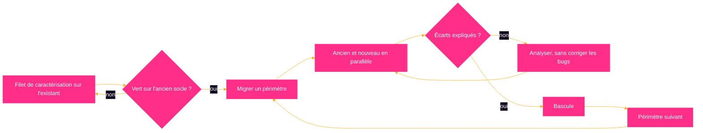

# 08. Migrer

Inspiré de : le motif *Strangler Fig* (Martin Fowler), les tests de caractérisation (Michael Feathers).

Une migration de socle (version de langage, framework, base de données, hébergement) est le moment où une équipe perd le plus facilement la confiance de ses utilisateurs. Rien de visible ne change pour eux ; tout ce qui casse leur paraît donc gratuit.

## Règle 1 : figer le comportement

Pendant une migration, on ne corrige aucun bug. Même évident, même ancien, même gênant. On le note, on le garde pour après.

La raison est simple : si le comportement change pendant la migration, personne ne peut plus dire si l'écart vient de la migration ou de la correction. Une seule variable à la fois.

## Règle 2 : le filet se joue sur l'existant

Avant de toucher quoi que ce soit, on écrit les tests qui photographient ce que fait le système **aujourd'hui, sur sa pile actuelle**. Pas sur la cible. Le filet doit d'abord passer au vert sur l'ancien monde ; il passera ensuite sur le nouveau, ou il dira précisément ce qui a changé.

Ces tests décrivent les défauts aussi. C'est inconfortable à écrire, et c'est exactement le but.

## Règle 3 : par morceaux

On migre un périmètre à la fois, derrière une frontière claire, en gardant l'ancien chemin disponible jusqu'à ce que le nouveau ait fait ses preuves en production. Le grand soir où tout bascule d'un coup n'existe que dans les plannings.

## Règle 4 : comparer, pas supposer

Quand c'est possible, l'ancien et le nouveau tournent en parallèle sur le même trafic, et on compare les sorties. Un écart n'est pas forcément une erreur, mais il est toujours une question.

## Ce que je ne fais plus

Mélanger migration et refonte. « Tant qu'on y est » est la phrase la plus coûteuse que je connaisse en ingénierie.
