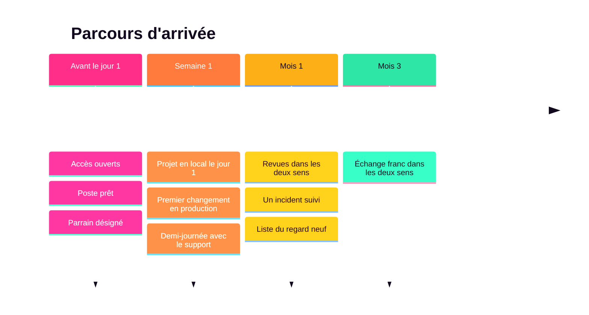

# 09. Accueillir

Inspiré de : *The Manager's Path* (Camille Fournier), *Team Topologies* (Skelton, Pais) pour la charge cognitive.

L'arrivée d'une personne dit tout de l'état d'une équipe. Si elle met trois semaines à faire tourner le projet en local, ce n'est pas elle le problème.

## Avant le premier jour

Accès ouverts, poste prêt, un parrain ou une marraine désigné. Ce n'est pas le manager : c'est quelqu'un à qui l'on peut poser une question bête sans y penser à deux fois.

## Première semaine

- Le projet tourne en local le premier jour. Si ce n'est pas le cas, la première tâche du nouvel arrivant est de corriger la documentation qui l'en a empêché.
- Un premier changement en production avant la fin de la semaine. Petit, réel, relu, déployé par lui-même.
- Une demi-journée avec le support ou les utilisateurs, pour voir le produit depuis l'autre côté.

## Premier mois

- Participer à une revue de code dans chaque sens.
- Suivre un incident, ou en relire deux post-mortems récents.
- Rédiger, à partir de son regard neuf, la liste de ce qui lui a semblé étrange, lent ou incompréhensible. Cette liste vaut de l'or ; elle ne restera fraîche que quelques semaines.

## Trois mois

Un échange franc, dans les deux sens : ce que l'équipe attend de la personne, ce que la personne attend de l'équipe, et ce qui ne correspond pas à ce qu'on lui avait promis au recrutement.
