# 10. Mesurer

Inspiré de : les quatre indicateurs DORA, le cadre SPACE (Forsgren, Storey et al.).

## Les quatre indicateurs de livraison

```mermaid
%%{init: {'theme':'base','themeVariables':{'primaryColor':'#FF2E88','primaryTextColor':'#ffffff','primaryBorderColor':'#FF2E88','lineColor':'#FCAF17','secondaryColor':'#2A0F3D','tertiaryColor':'#FFF0F6','clusterBkg':'#FFF0F6','clusterBorder':'#FF2E88','titleColor':'#12091F','edgeLabelBackground':'#12091F','textColor':'#12091F','transitionLabelColor':'#ffffff','fontFamily':'Segoe UI, Helvetica, Arial, sans-serif','cScale0':'#FF2E88','cScaleLabel0':'#ffffff','cScale1':'#FF7A3D','cScaleLabel1':'#ffffff','cScale2':'#FCAF17','cScaleLabel2':'#12091F','cScale3':'#2EE6A6','cScaleLabel3':'#12091F','cScale4':'#28D9E8','cScaleLabel4':'#12091F','cScale5':'#C04DFF','cScaleLabel5':'#ffffff','cScale6':'#7A5CFF','cScaleLabel6':'#ffffff','cScale7':'#FF4F70','cScaleLabel7':'#ffffff'}}}%%
flowchart LR
  subgraph V["Vitesse"]
    direction TB
    V1["Fréquence de déploiement"]
    V2["Délai de mise en production"]
  end
  subgraph S["Stabilité"]
    direction TB
    S1["Taux d'échec des changements"]
    S2["Temps de rétablissement"]
  end
  subgraph H["Santé de l'équipe, SPACE"]
    direction TB
    H1["Satisfaction"]
    H2["Collaboration"]
    H3["Fluidité"]
  end
  V --- S
  S --- H
```

| Indicateur | Ce qu'il dit |
|---|---|
| Fréquence de déploiement | À quel rythme la valeur arrive chez les utilisateurs |
| Délai de mise en production | Combien de temps un changement fusionné attend avant d'être utile |
| Taux d'échec des changements | Quelle part des livraisons provoque un incident ou un retour arrière |
| Temps de rétablissement | Combien de temps les utilisateurs subissent une panne |

Les deux premiers mesurent la vitesse, les deux derniers la stabilité. Les suivre ensemble empêche de sacrifier l'une à l'autre sans s'en rendre compte.

## Ce que DORA ne voit pas

La santé de l'équipe. Une équipe peut afficher d'excellents chiffres en s'épuisant. Le cadre SPACE rappelle qu'il faut aussi regarder la satisfaction, la collaboration et la fluidité du travail. Je le fais par un court questionnaire trimestriel et, surtout, par des entretiens individuels réguliers.

## Les règles

**On mesure un système, jamais une personne.** Le jour où un indicateur sert à évaluer quelqu'un, il cesse d'être fiable : chacun apprend à le faire monter plutôt qu'à faire du bon travail. C'est la loi de Goodhart, et elle ne rate jamais.

**On regarde des tendances, pas des valeurs.** Un chiffre isolé ne dit rien. Sa courbe sur trois mois dit beaucoup.

**Chaque indicateur suivi déclenche une action possible.** Une mesure qui ne change aucune décision n'est que du bruit dans un tableau de bord.
