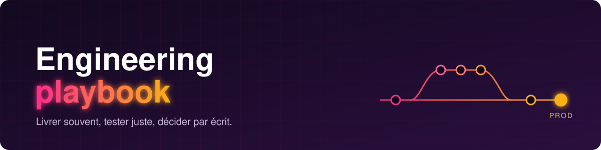
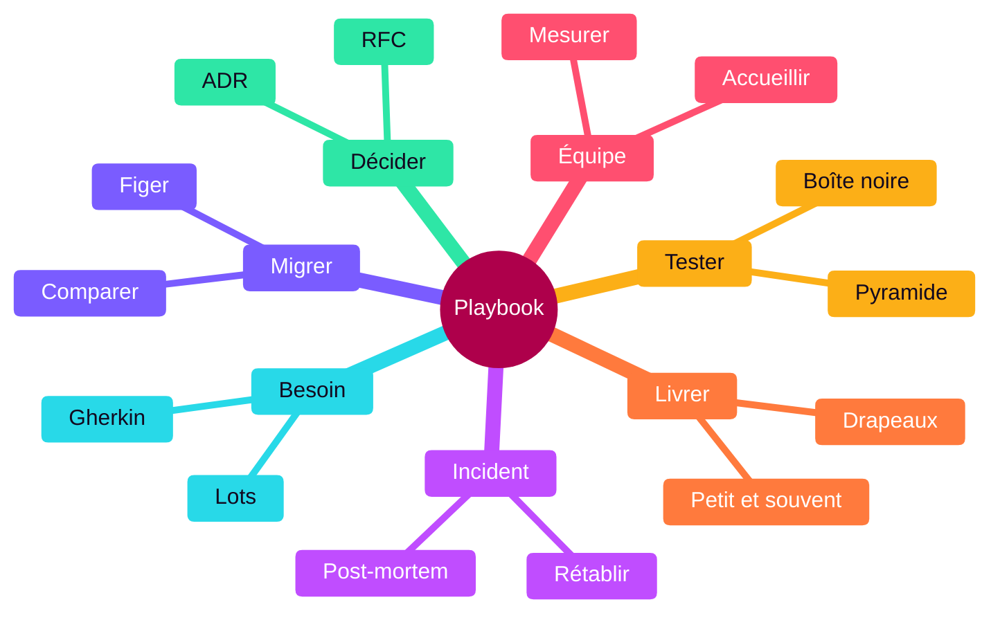

# Engineering playbook

Ma façon de faire tourner une équipe technique.

Rien ici n'est inventé de toutes pièces. Ce playbook emprunte à des pratiques éprouvées (DORA, le post-mortem sans blâme des équipes SRE de Google, les ADR de Michael Nygard, Team Topologies, le développement trunk-based) et les passe au filtre de ce que j'ai vu fonctionner, ou échouer, sur des plateformes où une erreur en production coûte de l'argent réel à des gens réels.

Ce n'est pas un règlement. C'est un point de départ que chaque équipe a le droit de contester, à condition d'écrire pourquoi.

## La carte

## Sommaire

| | Chapitre | En une phrase | Détails |
|---|---|---|---|
| 01 | [Principes](01-principes.md) | Ce qui tranche quand les règles se taisent. | [wiki](https://github.com/Harrylepap/engineering-playbook/wiki/01-Principes) |
| 02 | [Livrer](02-livrer.md) | Des changements petits, fréquents, réversibles. | [wiki](https://github.com/Harrylepap/engineering-playbook/wiki/02-Livrer) |
| 03 | [Tester](03-tester.md) | Chaque niveau de test répond à une question différente. | [wiki](https://github.com/Harrylepap/engineering-playbook/wiki/03-Tester) |
| 04 | [Relire le code](04-relire-le-code.md) | La revue sert à transmettre, pas à filtrer. | [wiki](https://github.com/Harrylepap/engineering-playbook/wiki/04-Relire-le-code) |
| 05 | [Décider](05-decider.md) | Une décision qui n'est pas écrite sera reprise. | [wiki](https://github.com/Harrylepap/engineering-playbook/wiki/05-Decider) |
| 06 | [Exprimer un besoin](06-exprimer-un-besoin.md) | Un besoin se lit du point de vue de celui qui l'utilise. | [wiki](https://github.com/Harrylepap/engineering-playbook/wiki/06-Exprimer-un-besoin) |
| 07 | [Gérer un incident](07-gerer-un-incident.md) | D'abord rétablir, ensuite comprendre, jamais accuser. | [wiki](https://github.com/Harrylepap/engineering-playbook/wiki/07-Gerer-un-incident) |
| 08 | [Migrer](08-migrer.md) | On fige le comportement avant de toucher au socle. | [wiki](https://github.com/Harrylepap/engineering-playbook/wiki/08-Migrer) |
| 09 | [Accueillir](09-accueillir.md) | Un premier commit en production la première semaine. | [wiki](https://github.com/Harrylepap/engineering-playbook/wiki/09-Accueillir) |
| 10 | [Mesurer](10-mesurer.md) | On mesure un système, jamais une personne. | [wiki](https://github.com/Harrylepap/engineering-playbook/wiki/10-Mesurer) |

Le [wiki](https://github.com/Harrylepap/engineering-playbook/wiki) reprend chaque chapitre en détail : le raisonnement, la mise en pratique, les signaux d'alerte, les objections et les sources.

## Modèles

- [Décision d'architecture (ADR)](modeles/adr.md)
- [Proposition technique (RFC)](modeles/rfc.md)
- [Demande d'évolution](modeles/demande.md)
- [Post-mortem](modeles/post-mortem.md)

## Licence

Texte sous [CC BY 4.0](LICENSE). Reprenez, adaptez, citez la source.
